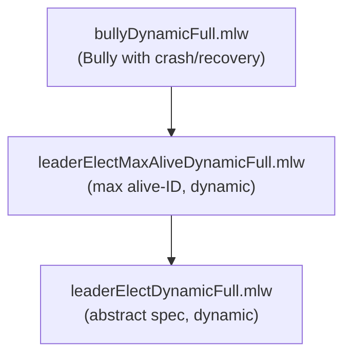

# Dynamic Bully Leader Election

Formalization, by multi-step refinement, of a dynamic Bully leader
election algorithm with crash and recovery of nodes.

## Files

- [leaderElectDynamicFull.mlw](leaderElectDynamicFull.mlw): abstract
  specification of dynamic leader election
- [leaderElectMaxAliveDynamicFull.mlw](leaderElectMaxAliveDynamicFull.mlw):
  specification based on maximum alive node ID in a dynamic setting.
  Refines leaderElectDynamicFull
- [bullyDynamicFull.mlw](bullyDynamicFull.mlw): concrete Bully algorithm
  with crash/recovery and message passing. Refines
  leaderElectMaxAliveDynamicFull

All files: *(Contribution by: Joao Goncalves, Carlos Pina. Adapted to
the why3do refinement framework.)*

## Refinement Hierarchy

## Limitations

- The concrete machine assumes a perfect failure detector
  (`fd_accurate`: it never suspects a live process) -- an assumption no
  asynchronous protocol can derive, and Bully's safety depends on it;
  it is confined to one guard and one invariant conjunct
- Recovery deposes an outranked incumbent atomically, in place of the
  Coordinator round that would inform the old leader; this is a
  synchrony assumption ("always at most one leader" is not an
  asynchronous safety property of Bully), inherited by the whole chain
- The max-alive machine's election guard quantifies over the whole
  alive set: a specification of which process must be chosen, not a
  check a process could evaluate locally
