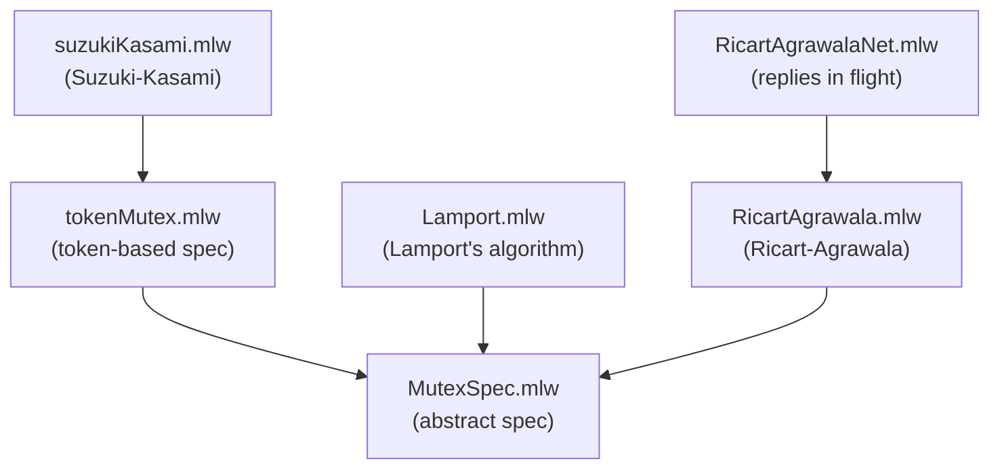

# Mutual Exclusion (Distributed)

Formalization, by specification refinement, of distributed mutual
exclusion algorithms using message passing.

## Files

- [MutexSpec.mlw](MutexSpec.mlw): abstract specification of mutual
  exclusion (critical section occupancy invariant)
- [tokenMutex.mlw](tokenMutex.mlw): intermediate specification based on
  a unique token. Refines MutexSpec
- [Lamport.mlw](Lamport.mlw): Lamport's distributed mutex algorithm
  using logical clocks, per-process request timestamps and
  acknowledgments. Refines MutexSpec. The model has no request queues
  (a deviation from the published algorithm: instead of queuing
  requests, a process tracks that every other process has acked its
  timestamp)
  *(Original model by: Joao Duarte, Luis Silva. Adapted to the why3do
  refinement framework, with corrections to the clock update and reply
  guard.)*
- [RicartAgrawala.mlw](RicartAgrawala.mlw): Ricart-Agrawala distributed
  mutex algorithm. Refines MutexSpec
  *(Original model by: Claudia Pinto, Patricia Carvalho. Adapted to the
  why3do refinement framework.)*
- [RicartAgrawalaNet.mlw](RicartAgrawalaNet.mlw): Ricart-Agrawala with
  replies in flight: grant_Reply is split into send_Reply and
  deliver_Reply. Refines RicartAgrawala, turning its collapsed-
  send-and-receive limitation (and the stale-request assumption it
  carries) into proved properties
- [suzukiKasami.mlw](suzukiKasami.mlw): Suzuki-Kasami distributed mutex
  algorithm using a token with a queue. Refines tokenMutex

## Refinement Hierarchy

## Limitations

- Safety only: mutual exclusion, with no starvation-freedom or other
  progress property
- tokenMutex says "at most one token", not "exactly one"; token
  conservation is each refiner's own obligation, and acquireToken's
  guard (nobody holds the token) is a specification device a real
  process cannot evaluate
- RicartAgrawala collapses sending and receiving a reply into one
  atomic step, so a reply is never in flight and requests are assumed
  not to go stale; RicartAgrawalaNet discharges this by putting replies
  on the wire -- but requests are still instantaneous, and the wire is
  a slot, not a queue (no duplication, loss or reordering)
- suzukiKasami's token queue is a set, not a FIFO: safety here is the
  stronger result, but the arrival order that Suzuki-Kasami relies on
  for starvation-freedom is discarded, and the queue and last-request
  numbers are global fields rather than a token payload
- Lamport.mlw has no request queues (see above); its `acks` component
  records acknowledgments per pair, standing in for the published
  algorithm's per-process queues
