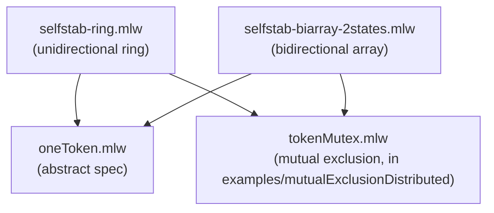

# Mutual Exclusion by Neighbor Communication

Formalization, by specification refinement, of token-based mutual
exclusion algorithms in which each process communicates only with its
topological neighbors, by reading their state. Specifically, the closure
property of Dijkstra's self-stabilizing systems, and — on top of it —
mutual exclusion: each system also refines tokenMutex (in
`examples/mutualExclusionDistributed`), which carries the argument that
a unique token yields mutual exclusion of the critical sections.

## Files

- [oneToken.mlw](oneToken.mlw): abstract specification of single-token
  systems
- [selfstab-ring.mlw](selfstab-ring.mlw): Dijkstra's unidirectional
  ring system (stable phase, closure property). Refines oneToken, and
  refines tokenMutex: each process has a critical-section flag,
  `enter_cs` is guarded by holding the (derived) token, and the token
  cannot move while its holder is in the critical section
- [selfstab-biarray-2states.mlw](selfstab-biarray-2states.mlw):
  Dijkstra's bidirectional array system (stable phase, closure
  property). Refines oneToken and tokenMutex in the same way

## Refinement Hierarchy

## Limitations

- Only the closure (stable) phase is modelled: starting from a stable
  one-token configuration, the machines preserve the token. The
  convergence half of self-stabilization -- reaching such a
  configuration from an arbitrary one -- is not addressed
- The bidirectional array proof covers 2-value configurations only;
  one-token configurations with three or more distinct values, which
  occur in the final steps of convergence, are out of scope
- Token movement is a single atomic step (refining tokenMutex's
  `transfer`), matching the shared-neighbour-state model rather than a
  message-passing one
- Safety only: no fairness, and no bound on how long a token holder
  waits before passing it on
