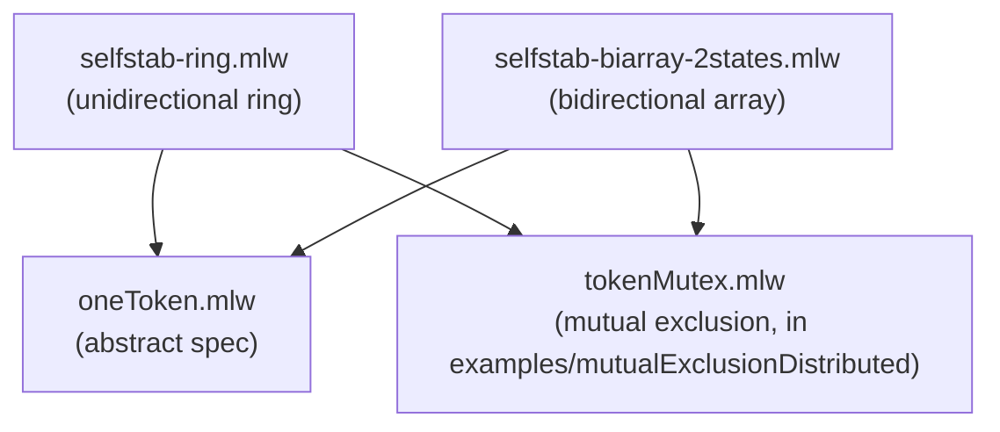

# Mutual Exclusion by Token-passing

Formalization, by specification refinement, of token-based mutual
exclusion algorithms. Specifically, the closure property of Dijkstra's
self-stabilizing systems, and — on top of it — mutual exclusion: each
system also refines tokenMutex (in `examples/mutualExclusionDistributed`),
which carries the argument that a unique token yields mutual exclusion
of the critical sections.

## Files

- [oneToken.mlw](oneToken.mlw): abstract specification of single-token
  systems
- [selfstab-ring.mlw](selfstab-ring.mlw): Dijkstra's unidirectional
  ring system (stable phase, closure property). Refines oneToken, and
  refines tokenMutex: each process has a critical-section flag,
  `enter_cs` is guarded by holding the (derived) token, and the token
  cannot move while its holder is in the critical section
- [selfstab-biarray-2states.mlw](selfstab-biarray-2states.mlw):
  Dijkstra's bidirectional array system (stable phase, closure
  property). Refines oneToken and tokenMutex in the same way

## Refinement Hierarchy

