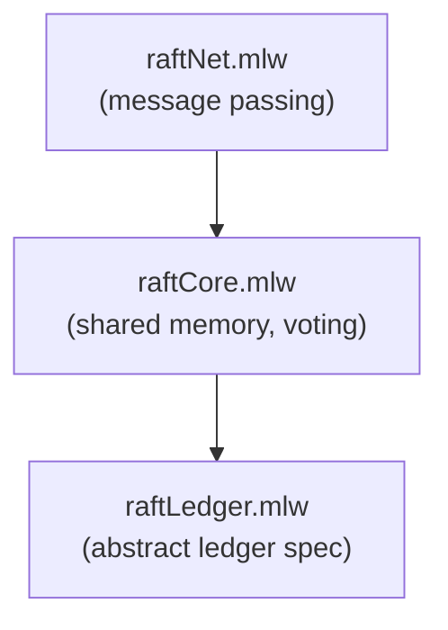

# Raft Leader Election

Formalization, by a three-step refinement chain, of the Raft leader
election protocol. The model progresses from an abstract ledger of
terms, through a shared-memory version with voting and quorums, to a
concrete message-passing implementation.

## Files

- [raftLedger.mlw](raftLedger.mlw): abstract specification -- a ledger
  of terms with a single leader per term
- [raftCore.mlw](raftCore.mlw): intermediate specification with shared
  memory, voting, and quorum reasoning. Refines raftLedger
- [raftNet.mlw](raftNet.mlw): concrete implementation with message
  passing over a network. Refines raftCore

All files: *(Contribution by: Ana Sa Oliveira, Edgar Araujo, Gabriel
Paiva. Adapted to the why3do refinement framework.)*

## Refinement Hierarchy

## Limitations

- Quorums are abstract: `quorum_overlap` is an assumption, not the
  pigeonhole principle, and nothing relates quorums to majorities;
  the axiom is also what forces quorums non-empty
- `grantVote`'s guard is the voter's local check: it does not require
  the requester to have reached that term, nor to currently be a
  Candidate -- facts about the requester that a voter cannot observe
- The network layer models delay, duplication and reordering with
  monotone sent-sets, but no bounded loss and no garbage collection;
  `n_nodes` is fixed and nodes never crash or restart
- Safety only: no liveness, fairness or timing model, and the ledger's
  terms are unbounded so nothing says elections are finite in number
