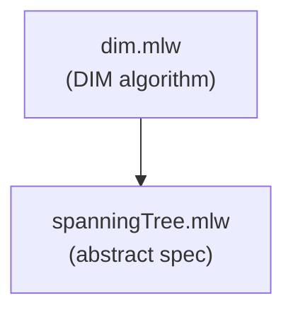

# Spanning Tree

DIM self-stabilizing spanning-tree construction (stable phase): each
node keeps a parent pointer and a distance estimate, corrected by
adopting as parent a neighbor of minimum distance; the root resets
its distance to 0. The legitimate states are those where the table
is a tree rooted at the root (abstract invariant) and distances
differ by at most one along an edge (slack). Under both, every
correction is distance-preserving, so the refinement shows
legitimacy is closed, and that the distances are the BFS depths.

## Files

- [spanningTree.mlw](spanningTree.mlw): abstract specification of a
  repaired parent/distance table -- tree invariant,
  distance-preserving re-parenting, root reset, and the rootedness
  theorem
- [dim.mlw](dim.mlw): the DIM algorithm (stable phase, closure
  property), refining SpanningTree by the identity map and adding
  the slack invariant; proves the table is rooted, chain lengths
  equal distances, and no graph path from the root beats a node's
  distance (BFS optimality)

## Refinement Hierarchy

## Limitations

- Only the closure (stable) phase is modelled: starting from a
  legitimate configuration, the machine preserves legitimacy. The
  convergence half of self-stabilization -- reaching such a
  configuration from an arbitrary one -- is not addressed
- The root's correction step is enabled only in states that violate
  the invariant, so it is vacuous along legitimate states
- The existence of legitimate states is not derivable from the
  axioms on the abstract edge relation; no non-vacuity witness is
  provided
- The topology is an abstract symmetric edge relation; concrete
  network structures are out of scope
